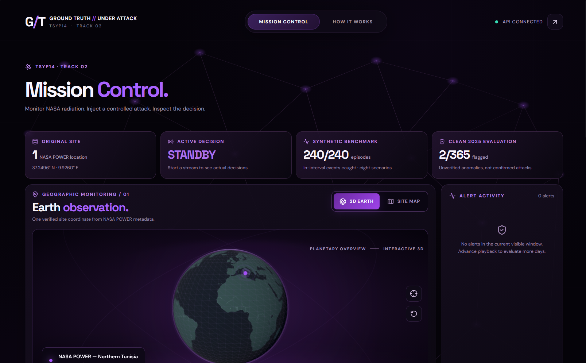
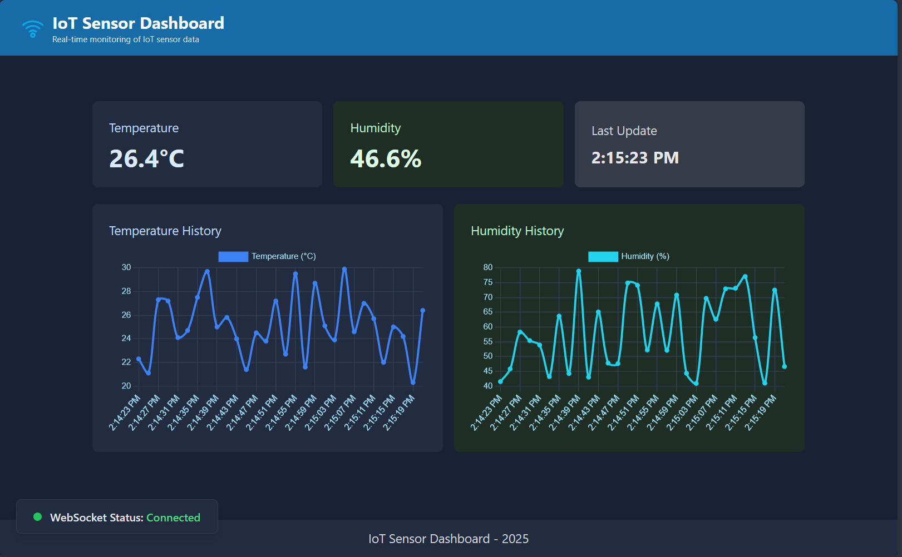
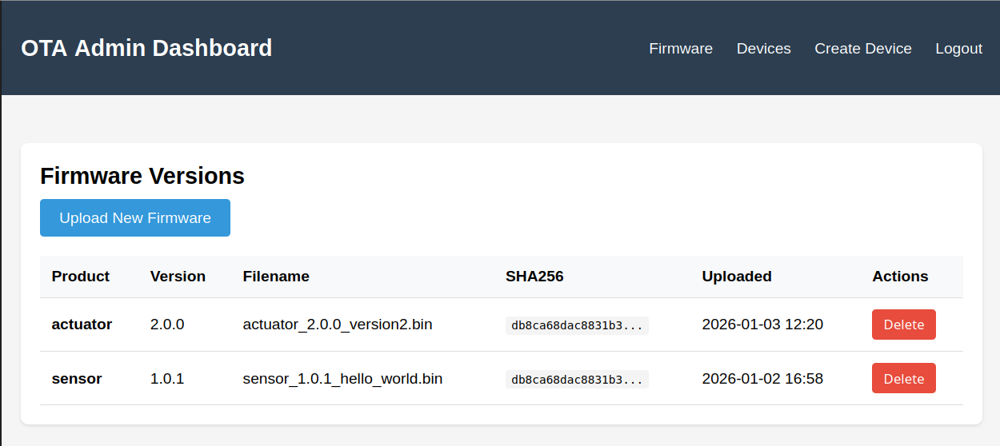
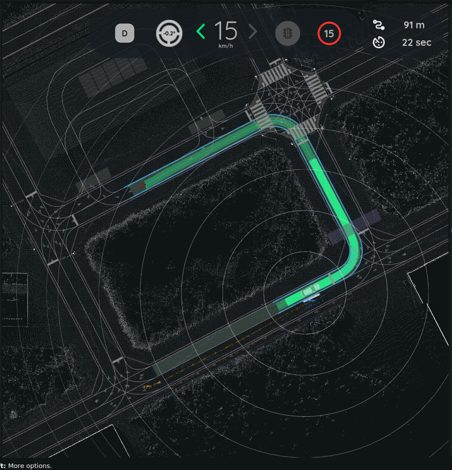
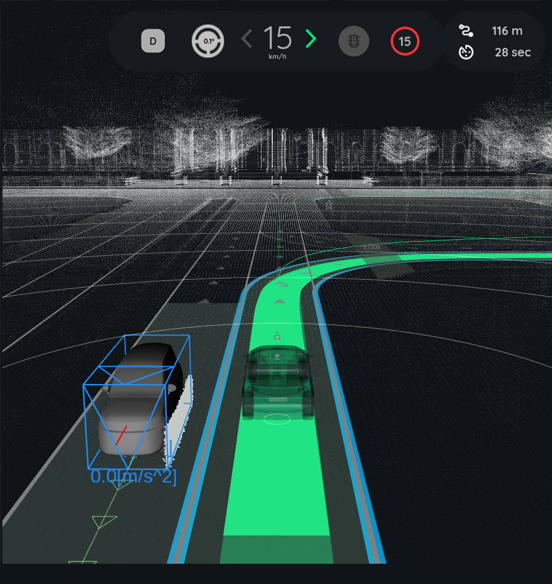
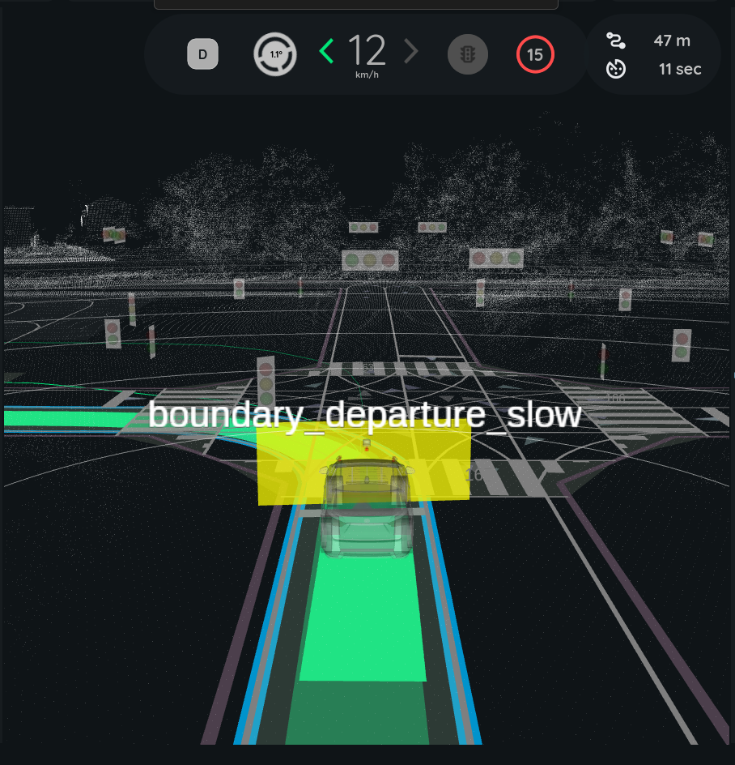
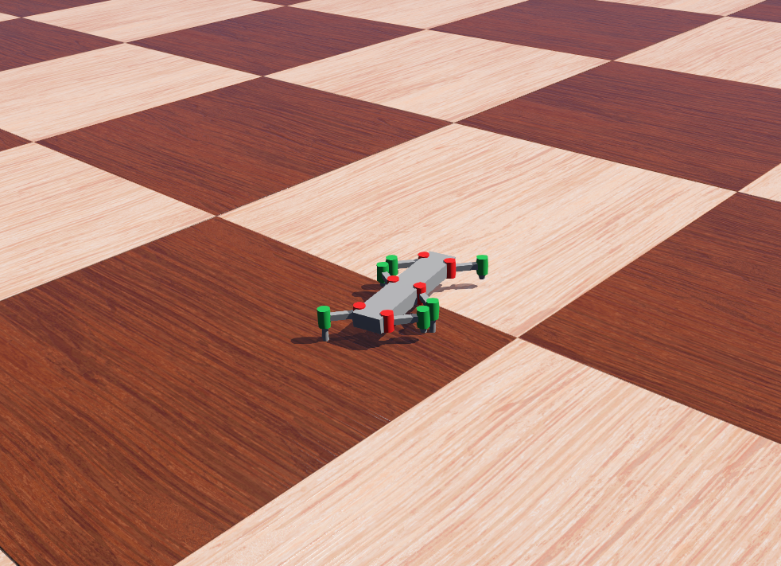
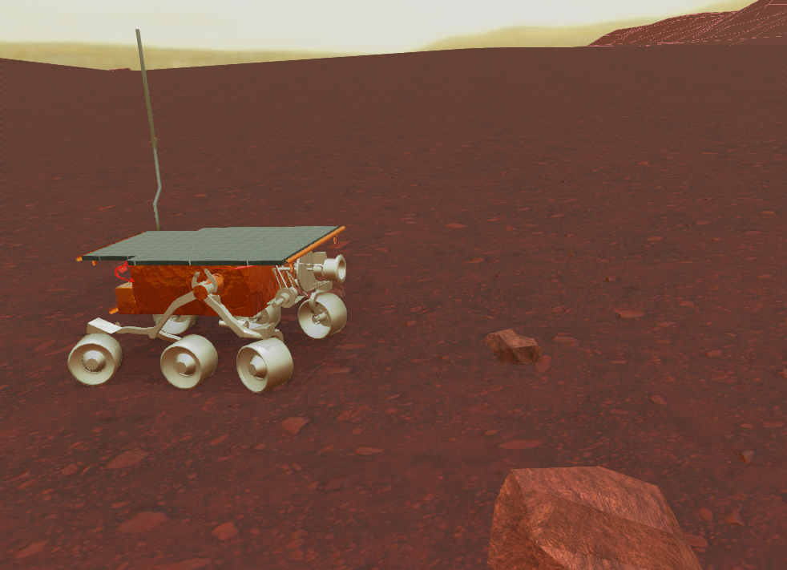

# Amen Ellah Kerimi

### Computer Engineering Graduate | Software Development & Embedded Systems

*Building software by day. Building robots after hours.*

## About Me

I'm a Computer Engineer specializing in **Embedded Systems & IoT**.

My work spans software development and embedded engineering, from building full-stack applications and backend systems to developing firmware and connected devices.

Beyond that, I'm interested in robotics, autonomous systems, and intelligent machines — exploring how software, hardware, and AI come together to build real-world systems.

## ☀️ Day Shift — Software & Embedded Engineering

### Software Development

  <strong>Languages:</strong>&nbsp;
  
  
  
  
  

  <strong>Frontend:</strong>&nbsp;
  
  
  

  <strong>Backend & Mobile:</strong>&nbsp;
  
  
  

  <strong>Databases:</strong>&nbsp;
  
  
  

  <strong>AI & LLM Engineering:</strong>&nbsp;
  
  
  
  

  <strong>Deployment & DevOps:</strong>&nbsp;
  
  
  
  
  

#### Selected Projects

<table>
  <tr>
    <td width="50%" valign="top">
      <h3>Ground Truth Under Attack</h3>
      
      
Monitoring system designed to detect false data injection and anomalies in energy data.

    </td>
    <td width="50%" valign="top">
      <h3>IoT Dashboard</h3>
      
      
Web dashboard for monitoring and interacting with connected IoT systems.

    </td>
  </tr>
</table>

### Embedded Systems & IoT

  <strong>Languages:</strong>&nbsp;
  
  
  

  <strong>Hardware & Platforms:</strong>&nbsp;
  
  
  
  

  <strong>Firmware & RTOS:</strong>&nbsp;
  
  
  
  

  <strong>Communication & Connectivity:</strong>&nbsp;
  
  
  
  
  
  
  

#### Selected Projects

<table>
  <tr>
    <td width="100%" valign="top">
      <h3>Secure OTA Update System</h3>
      
      
Secure over-the-air firmware update system with a management dashboard.

    </td>
  </tr>
</table>

## 🌙 Night Shift — Robotics & Autonomous Systems

  <strong>Programming:</strong>&nbsp;
  
  
  

  <strong>Frameworks & Middleware:</strong>&nbsp;
  

  <strong>Simulation & Engineering:</strong>&nbsp;
  
  
  
  
  
  
  

  <strong>AI & Robotics Learning:</strong>&nbsp;
  
  
  
  

<table>
  <tr>
    <td width="50%" valign="top">
      <h3 align="center">Orion — Autonomous Robot Taxi</h3>
      

        
        
        
      

      
Autonomous driving simulation using Autoware, covering vehicle navigation and road scenarios.

    </td>
    <td width="50%" valign="top">
      <h3 align="center">Simulation & Control Experiments</h3>
      

        
        
      

      
Robotics simulation and control experiments exploring different robot platforms and locomotion.

    </td>
  </tr>
</table>

---

  <i>Always building, always experimenting.</i>

